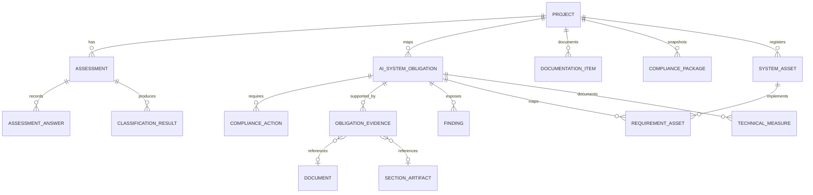

# Workflow domain model

## Aggregate boundary

`Project` is the canonical aggregate for one registered AI system in a company
context. The UI may call it an “AI system” for clarity, but backend ownership,
authorization, and persistence resolve through the project and its company.

## Ownership map

| Concept | Owns writes | Inputs | Outputs/consumers |
| --- | --- | --- | --- |
| Project registration | projects/AI-systems domain | company membership, system profile | assessment, documents, workflow |
| Assessment | assessments domain | answers, regulatory framework version | preliminary classification and applicability rationale |
| Classification review | assessment/review policy | preliminary result, reviewer identity | reviewed decision and requirement mapping trigger |
| Obligation | obligations domain | reviewed assessment and regulatory content | actions, findings, evidence links, approval state |
| Evidence | evidence/document domain | uploaded file or external proof metadata | immutable version/provenance and requirement link |
| Project workflow | workflow/review domain | readiness, actor authorization, decisions | status/event history and change requests |
| Reporting | reporting domain | reviewed workflow state and traceability | readiness report and immutable package |

## Invariants

- Every project-scoped query and command is authorized by company membership.
- System ownership, actor identity, timestamps, and audit identity are derived
  from server context, not trusted from client input.
- An evidence item can support a requirement only through an explicit
  obligation-evidence relationship.
- A review decision is distinct from an automated recommendation.
- Package verification reads immutable package facts rather than mutable UI
  progress state.

## Conceptual traceability direction

The database already expresses much of the required chain. The preferred query
direction is:

`Project → Assessment/Classification → Obligation → Action/Evidence/Finding → Review → Report/Package`.

System assets, asset-to-requirement mappings, technical measures, documentary
evidence and assessments have persisted relationships. A requirement catalogue
entry carries its article reference and trustworthiness principle.
Engineering requirements remain represented through catalogue descriptions,
architecture elements and linked work. Neuraldocx does not maintain a separate
engineering requirements registry.

The correspondence above is an implementation mapping to the concepts in the
publisher's abstract. [Ekeh et al., BIR 2026 proceedings](https://link.springer.com/chapter/10.1007/978-3-032-38498-0_10).

Project status and package freshness are deliberately distinct. Audit events
record material changes and decision history. The workflow summary evaluates
those facts at read time and uses the same evidence checks as the package gate
for current supporting proof.
