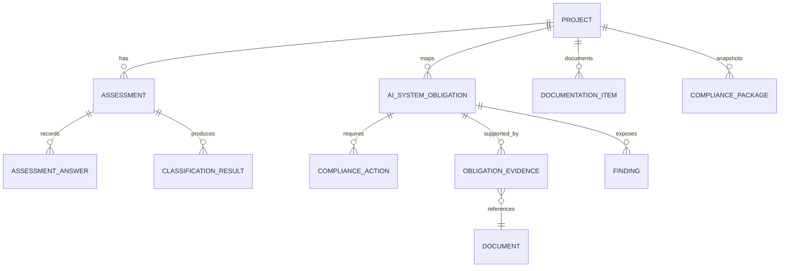

# Workflow domain model

## Aggregate boundary

`Project` is the canonical aggregate for one registered AI system in a company
context. The UI may call it an “AI system” for clarity, but backend ownership,
authorization, and persistence resolve through the project and its company.

## Ownership map

| Concept | Owns writes | Inputs | Outputs/consumers |
| --- | --- | --- | --- |
| Project registration | projects/AI-systems domain | company membership, system profile | assessment, documents, workflow |
| Assessment | assessments domain | answers, regulatory framework version | preliminary classification and applicability rationale |
| Classification review | assessment/review policy | preliminary result, reviewer identity | reviewed decision and requirement mapping trigger |
| Obligation | obligations domain | reviewed assessment and regulatory content | actions, findings, evidence links, approval state |
| Evidence | evidence/document domain | uploaded file or external proof metadata | immutable version/provenance and requirement link |
| Project workflow | workflow/review domain | readiness, actor authorization, decisions | status/event history and change requests |
| Reporting | reporting domain | reviewed workflow state and traceability | readiness report and immutable package |

## Invariants

- Every project-scoped query and command is authorized by company membership.
- System ownership, actor identity, timestamps, and audit identity are derived
  from server context, not trusted from client input.
- An evidence item can support a requirement only through an explicit
  obligation-evidence relationship.
- A review decision is distinct from an automated recommendation.
- Package verification reads immutable package facts rather than mutable UI
  progress state.

## Conceptual traceability direction

The database already expresses much of the required chain. The preferred query
direction is:

`Project → Assessment/Classification → Obligation → Action/Evidence/Finding → Review → Report/Package`.

P2 work should fill observed gaps with durable relation or audit records, not a
second “workflow state” table. The existing traceability-model migration work
should be reconciled with this model before adding another schema change.
