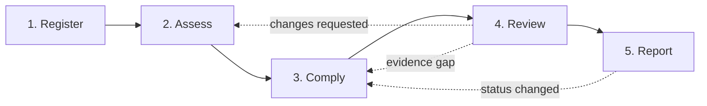

# Target workflow

## Product rule

Neuraldocx is compliance-first: users establish and review the compliance
position before producing documentation. Generated documentation reports the
reviewed state; it is not a substitute for evidence, approval, or legal advice.

## Canonical journey

| Stage | User outcome | Authoritative data | Primary route | Entry/exit condition |
| --- | --- | --- | --- | --- |
| Register | An AI system is known, owned, and scoped. | `Project` and company membership | `/projects/:projectId/ai-system-profile` | Create a project; record minimum system context. |
| Assess | Applicability and preliminary classification are explainable. | `Assessment`, answers, `ClassificationResult` | `/projects/:projectId/classification` and `/assessment` | Start with scope questions; exit only after a human review decision where required. |
| Comply | Applicable requirements have owners, actions, and current evidence. | obligations, actions, findings, evidence, documentation items | `/requirements`, `/evidence`, `/findings` | Enter after assessment result; exit when applicable work is ready for review. |
| Review | Authorized people have approved, rejected, or requested changes with an audit trail. | workflow events, approval state, review records | `/review-approval` | Enter from readiness; rejected work returns to Assess or Comply. |
| Report | A verified, versioned package represents the reviewed state. | readiness report, documents, `CompliancePackage` | `/compliance-package` | Generate only from a readiness check; invalidate/supersede when source status changes. |

## Navigation contract

The project overview is the stage gateway and owns the single **next action**.
It may show progress and blockers, but it must not independently recalculate
regulatory outcomes. It consumes the workflow-summary read model and links to
the owning stage.

Primary project navigation should expose only:

1. Overview
2. Register
3. Assess
4. Comply
5. Review
6. Report

Evidence, requirements, findings, and documents remain task views under
**Comply**. Traceability, advanced metadata, messages, and legacy workspace
views remain available but are not parallel top-level journeys.

## State principles

- A classification result is preliminary until the designated human review is
  recorded.
- Evidence is current only when its version, provenance, review state, and
  expiry allow it to support the linked requirement.
- Requirement completion requires both evidence and the relevant approval
  decision; a percentage alone is not a compliance conclusion.
- A package is an immutable snapshot and does not make future changes compliant.
- Company/membership context is always resolved server-side for project data.
