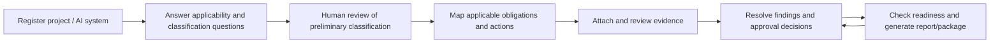

# Workflow audit

## Scope and method

This audit records the workflow that is implemented in the repository as of
2026-11-27. It is based on the Prisma schema, Nest controllers and services,
shared contracts, web routes, React Query consumers, and existing unit and E2E
tests. It deliberately does not treat an automated classification as a legal
conclusion: classification and approvals remain human-reviewable decisions.

The working tree contained substantial in-progress workflow and traceability
changes when this audit was written. Those changes are treated as in-scope
evidence, but have not been overwritten or consolidated by this documentation
pass.

## Verified current model

`Project` is the canonical aggregate for a registered AI system. There is no
separate Prisma `AiSystem` model. The historical `/ai-systems` APIs operate on
the same product concept and should be treated as a compatibility surface while
callers migrate to project-oriented routes and names.

| Concern | Existing source of truth | Primary API surface | Web surface |
| --- | --- | --- | --- |
| Register a system | `Project` | `ProjectsController` and `AiSystemsController` | dashboard, project profile, new-project modal |
| Assess applicability/classification | `Assessment`, `AssessmentAnswer`, `ClassificationResult` | `AssessmentsController` | `ProjectQuestionnairePage`, `ProjectAssessmentPage` |
| Map and execute requirements | `AiSystemObligation`, `ComplianceAction`, `Finding` | `ObligationsController` | requirements, findings, traceability pages |
| Collect and evaluate proof | `ObligationEvidence`, `DocumentationItem`, `Document` | obligations/evidence and sections APIs | evidence, project workspace, documents |
| Human review and workflow | workflow status/events and approval states | project workflow controllers and obligation review APIs | review/approval, reviews |
| Report and archive | readiness/report data and `CompliancePackage` | reporting/readiness/generation controllers | compliance package, documents |

## Observed user flow

The graph is intentionally iterative. Evidence rejection, changed answers,
scope changes, or review feedback return work to an earlier stage; they do not
create a second workflow.

## What is already working toward the target

- `apps/web/src/domains/ai-systems/lib/project-attention.ts` already turns
  persisted classification, requirement, evidence, document, and workflow
  states into a prioritised next action. It differentiates blockers, action
  required, and waiting states and is covered by focused tests.
- Project-specific pages already split the workflow into overview, profile,
  classification/assessment, requirements, evidence, findings, review,
  documentation, package, and traceability views.
- Reporting has separate readiness and generation surfaces, including package
  verification, rather than treating a generated file as proof of compliance.
- The database models retain evidence version/provenance and package snapshots,
  supporting the traceability described in `docs/product/evidence-model.md`.

## Simplification opportunities and risks

| Priority | Finding | Consequence | Safe direction |
| --- | --- | --- | --- |
| P0 | `/projects/:projectId`, dedicated project pages, and the legacy `ProjectPage` coexist. | Users can reach the same concept through different navigation and state paths. | Keep legacy routes as adapters while dedicated stage routes become canonical. Redirect only after route-level parity tests. |
| P0 | `ProjectPage.tsx` is a large legacy workspace (over 3,400 lines). | It concentrates navigation, state, and view concerns. | Extract stage containers behind existing routes; do not rewrite the aggregate workflow in one change. |
| P0 | `/ai-systems` and `/projects` terminology coexist. | API/UI semantics are harder to explain. | Use “AI system” in user language and `Project` as the internal aggregate; publish an alias/deprecation plan. |
| P1 | Assessment/classification, obligations, and readiness are individually authoritative but appear in more than one screen. | Duplicate client calculations can drift. | Expose a composed project workflow summary/read model, while preserving write ownership in each domain. |
| P1 | Global navigation exposes advanced and legacy destinations alongside the main flow. | New users must infer the intended order. | Make the five stages primary; move advanced, traceability, and raw workspace views behind “More”/advanced navigation. |
| P2 | Explicit links exist for many requirement/evidence paths, while some lifecycle and package relations are still assembled across read models. | Impact analysis is uneven. | Add only the missing durable relation/audit facts after confirming each query need. |

## Baseline verification status

This audit is intentionally non-destructive. Repository-wide build, lint, and
test results are recorded in [workflow-verification.md](workflow-verification.md).
The local runtime baseline previously confirmed authenticated API login and an
AI-system list request through the Vite proxy. That is a smoke check only, not
workflow certification.
